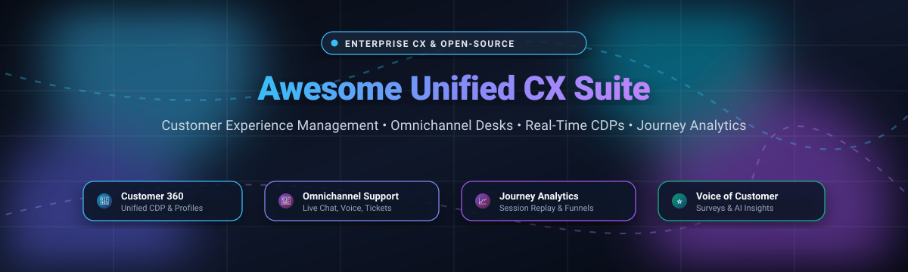

# 🌟 Awesome Unified Customer Experience (CX) Suite 🚀

  
  
  
  
  

> 🎯 A curated list of top **Unified Customer Experience (CX) Suite** platforms and frameworks — featuring enterprise SaaS/hosted solutions and top open-source alternatives for orchestrating customer data, multi-channel feedback, omnichannel ticketing, journey analytics, and conversational AI across the customer lifecycle. 🌐✨

⭐ **Star this repository if you find it helpful!** ⭐

---

## 📋 Table of Contents

- [🌐 Sector Overview & Market Dynamics](#-sector-overview--market-dynamics)
- [🟦 SaaS / Hosted Platforms](#-saas--hosted-platforms)
- [🟩 Open-Source Software](#-open-source-software)
- [📊 Comparison at a Glance](#-comparison-at-a-glance)
- [📈 Star History](#-star-history)
- [💖 Support & Sponsorship](#-support--sponsorship)
- [🤝 Contributing](#-contributing)
- [📄 License](#-license)

---

## 🌐 Sector Overview & Market Dynamics 📊

The global **Customer Experience (CX)** and **Customer Experience Management (CEM)** software market is estimated at **$14 billion to $18 billion** (scaling past **$25 billion** when including broader customer engagement ecosystems and professional consulting), expanding at a rapid **11% to 15% CAGR** driven by generative AI agents, unified customer data platforms (CDP), and real-time behavioral telemetry. 

The industry demonstrates a **moderately concentrated core at the top**—where legacy enterprise giants (Oracle, SAP, Salesforce, Adobe) maintain deeply entrenched positions across large organizations—alongside a **highly vibrant and fragmented landscape** of best-in-breed tools specializing in surveys/VoC, session replay, open-source ticketing desks, event tracking, and customer journey analytics. 🚀

---

## 🟦 SaaS / Hosted Platforms ☁️

Commercial, cloud-hosted Unified Customer Experience (CX) Suite platforms sorted by enterprise scale (market capitalization or valuation, descending). 🏢💼

| Company / Platform 🏷️ | Market Cap / Valuation / Scale 💰 | Starting Tier Price 💳 | Free Tier Limits / Free Trial Policy 🎁 | CX Focus & Core Strengths 🎯 |
|---|---|---|---|---|
| **[Oracle CX](https://www.oracle.com/cx/)** | ~$350B Market Cap (Oracle Corp) | $65 / user / month (Sales Cloud Professional, billed annually) | 30-day free trial (includes $300 cloud credits; access to core enterprise service apps) | Enterprise cloud CX suite combining Sales, Service, and Marketing with deep ERP/HCM back-office integration. 🏛️ |
| **[SAP Customer Experience](https://www.sap.com/products/crm.html)** | ~$270B Market Cap (SAP SE) | $58 / user / month (Service Cloud baseline, billed annually) | 30-day free trial on SAP Cloud ALM / CX demo environments (preconfigured guided scenarios) | End-to-end enterprise CX (SAP Sales & Service Cloud V2) natively connected to SAP S/4HANA workflows. 🏭 |
| **[Salesforce Customer 360](https://www.salesforce.com/products/)** | ~$180B Market Cap (Salesforce Inc.) | $25 / user / month (Starter Suite, billed annually) | 30-day free trial (full access to Starter Suite features; no credit card required) | Full-lifecycle enterprise CRM, Agentforce AI, Service Cloud, and Data Cloud unified customer 360 view. ☁️ |
| **[Adobe Experience Cloud](https://business.adobe.com/)** | ~$100B Market Cap (Adobe Inc.) | ~$2,083 / month (~$25,000 / year base entry tier for AEM Assets Prime) | 30-day enterprise sandbox trial (available via sales/partner program; custom sandbox limits) | Digital experience platform combining real-time CDP, headless content delivery (AEM), and customer analytics. 🎨 |
| **[Qualtrics XM](https://www.qualtrics.com/)** | $12.5B Valuation (Acquired by Silver Lake / CPP) | $420 / month ($5,040 / year billed annually for Strategic Research) | **Free Plan forever:** 30 questions/survey, 500 total responses/survey, up to 3 active surveys (or 30-day Pro trial up to 1,000 responses) | Enterprise experience management covering Customer Experience (CX), Employee Experience (EX), and market research. 📋 |
| **[Zendesk Suite](https://www.zendesk.com/)** | $10.2B Valuation (Acquired by Hellman & Friedman) | $19 / agent / month (Support Team) / $55 / agent / month (Suite Team) | 14-day free trial (full access to Zendesk Suite Professional; no credit card required; 14-day extension eligible) | Omnichannel customer service desk (ticketing, live messaging, voice, help center, and AI agent routing). 🎧 |
| **[Pegasystems](https://www.pega.com/)** | ~$5.6B Market Cap (NASDAQ: PEGA) | ~$150 / user / month (or case-based tiers starting at ~$0.45/case) | 30-day free trial (Pega Community Edition sandbox with full low-code app studio & workflow access) | Enterprise CRM and workflow automation engine powered by real-time AI decisioning and case management. ⚙️ |
| **[Freshworks Customer Service Suite](https://www.freshworks.com/)** | ~$3.5B Market Cap (NASDAQ: FRSH) | $19 / agent / month (Freshdesk Growth) / $29 / agent / month (Freshdesk Omni) | **Free Plan:** up to 2 agents on 6-month Free Program (or 14-day free trial of Pro omnichannel suite, no credit card) | Integrated customer service suite (Freshdesk ticketing, Freshchat omnichannel messaging, and Freddy AI). ⚡ |
| **[Sprinklr](https://www.sprinklr.com/)** | ~$1.6B Market Cap (NYSE: CXM) | ~$4,166 / month (~$50,000 / year enterprise entry contract) | Discontinued self-serve free trials (14 to 30-day custom enterprise POC pilots available upon sales approval) | Unified Customer Experience Management (Unified-CXM) covering social care, digital engagement, and VoC research. 📣 |
| **[Zoho CRM Plus](https://www.zoho.com/crm/crmplus/)** | ~$1.5B Annual Revenue (~$12B+ Valuation, Bootstrapped) | $57 / user / month (billed annually) or $69 / month | 30-day free trial (up to 10 users with full suite access across CRM, Desk, Campaigns, and Chat; no credit card) | All-in-one customer experience platform bundling CRM, helpdesk, marketing campaigns, visitor chat, and BI analytics. 🧩 |

---

## 🟩 Open-Source Software 🔓

Self-hosted, developer-friendly CX solutions and open software ecosystems. Repositories are sorted by GitHub Stars_Count (descending) with clickable real-time Stars_Badges linking directly to their stargazers page. 🌟🛠️

| Project & Repository 📦 | GitHub_Stars ⭐ | Tech Stack 💻 | License 📜 | CX Focus & Capabilities 🎯 |
|---|---|---|---|---|
| **[Twenty](https://twenty.com/)** [`twentyhq/twenty`](https://github.com/twentyhq/twenty) |  | TypeScript / NestJS / React | AGPL-3.0 | Modern open-source CRM alternative to Salesforce, built with full data sovereignty, extensible workflows, and AI companion tools. ⚡ |
| **[PostHog](https://posthog.com/)** [`PostHog/posthog`](https://github.com/PostHog/posthog) |  | Python / TypeScript / ClickHouse | MIT (Core) | All-in-one product analytics and CX suite: session replay, customer funnel analysis, feature flags, user surveys, and heatmap tracking. 🦔 |
| **[Novu](https://novu.co/)** [`novuhq/novu`](https://github.com/novuhq/novu) |  | TypeScript / React / Node.js | MIT | Open-source notification infrastructure and customer communication engine across in-app, push, email, SMS, and chat. 🔔 |
| **[Chatwoot](https://www.chatwoot.com/)** [`chatwoot/chatwoot`](https://github.com/chatwoot/chatwoot) |  | Ruby on Rails / Vue / PostgreSQL | MIT | Omnichannel customer communication platform combining live chat, WhatsApp, email, Facebook, Twitter, and SMS in a unified agent inbox. 💬 |
| **[Plausible Analytics](https://plausible.io/)** [`plausible/analytics`](https://github.com/plausible/analytics) |  | Elixir / ClickHouse / Tailwind | AGPL-3.0 | Privacy-first, lightweight, cookie-free web and customer journey analytics platform offering complete data ownership. 📊 |
| **[Formbricks](https://formbricks.com/)** [`formbricks/formbricks`](https://github.com/formbricks/formbricks) |  | TypeScript / Next.js / PostgreSQL | AGPL-3.0 | Privacy-first Experience Management (XM) platform and Qualtrics alternative for micro-surveys, customer feedback, and user retention tracking. 🧱 |
| **[OpenReplay](https://openreplay.com/)** [`openreplay/openreplay`](https://github.com/openreplay/openreplay) |  | Go / TypeScript / Python | El v2 | Developer-friendly session replay, cobrowsing, and product experience debugging suite you can self-host securely. 🎥 |
| **[Mautic](https://www.mautic.org/)** [`mautic/mautic`](https://github.com/mautic/mautic) |  | PHP / Symfony / MySQL | GPL-3.0 | Open-source marketing automation platform for lead nurturing, multi-channel customer campaigns, email marketing, and journey triggers. 📬 |
| **[OpenPanel](https://openpanel.dev/)** [`Openpanel-dev/openpanel`](https://github.com/Openpanel-dev/openpanel) |  | TypeScript / Next.js / ClickHouse | AGPL-3.0 | Modern product analytics platform and open Mixpanel alternative featuring uncapped session replay, funnel analysis, and cookieless tracking. 🔍 |
| **[SuiteCRM](https://suitecrm.com/)** [`SuiteCRM/SuiteCRM`](https://github.com/SuiteCRM/SuiteCRM) |  | PHP / Symfony / MySQL / MariaDB | AGPL-3.0 | Enterprise-grade open-source CRM platform providing sales automation, customer service ticketing, and campaign management. 💼 |
| **[FreeScout](https://freescout.net/)** [`freescout-help-desk/freescout`](https://github.com/freescout-help-desk/freescout) |  | PHP / Laravel / MySQL | AGPL-3.0 | Super-lightweight shared inbox and helpdesk alternative to Zendesk and Help Scout with no per-user fees or mailbox limits. 📥 |
| **[RudderStack Server](https://www.rudderstack.com/)** [`rudderlabs/rudder-server`](https://github.com/rudderlabs/rudder-server) |  | Go / Node.js | SSPL-1.0 | Customer Data Platform (CDP) and event-streaming engine for collecting, transforming, and routing customer event streams to your data warehouse. 🔄 |
| **[erxes](https://erxes.io/)** [`erxes/erxes`](https://github.com/erxes/erxes) |  | TypeScript / Node.js / MongoDB | AGPL-3.0 | Open-source Experience Operating System (XOS) unifying marketing, sales pipelines, team communications, and helpdesk ticketing. 🧭 |
| **[Chaskiq](https://chaskiq.io/)** [`chaskiq/chaskiq`](https://github.com/chaskiq/chaskiq) |  | Ruby on Rails / React | LGPL-3.0 | Conversational marketing and support platform alternative to Intercom and Drift, featuring live chat widgets, bot triggers, and newsletters. 💬 |
| **[Retentioneering](https://retentioneering.com/)** [`retentioneering/retentioneering-tools`](https://github.com/retentioneering/retentioneering-tools) |  | Python / DuckDB / Jupyter | Open Source | User behavioral analysis framework visualizing customer journey transition graphs, step Sankey diagrams, and trajectory exploration. 📉 |
| **[Tracardi](https://www.tracardi.com/)** [`Tracardi/tracardi`](https://github.com/Tracardi/tracardi) |  | Python / Docker / Elasticsearch | MIT + Clause | Composable Customer Data Platform (CDP) for collecting, unifying, and activating real-time user profiles across internal applications. 🗄️ |
| **[Znuny](https://www.znuny.org/)** [`znuny/Znuny`](https://github.com/znuny/Znuny) |  | Perl / JavaScript / PostgreSQL | GPL-3.0 | Service management desk and ticketing software (forked from OTRS) supporting custom SLAs, customer self-service portals, and ITSM. 🎫 |
| **[CX Impact](https://github.com/shelasmax/cx-impact)** [`shelasmax/cx-impact`](https://github.com/shelasmax/cx-impact) |  | Node.js / AI Agent Skill | Open Source | AI agent skill that translates process text and event data into customer journey maps, service blueprints, and sales funnels. 🗺️ |

---

## 📊 Comparison at a Glance 🔍

| Software 🏷️ | Deployment Model 🚀 | License / Cloud 📜 | Primary Focus 🎯 | Self-Hosted 🏠 | Starting Price 💵 | Free Tier / Trial Limit 🎁 |
|---|---|---|---|:---:|---|---|
| **Oracle CX** | SaaS | Commercial | Cloud CX Suite | ❌ | $65 / user / mo | 30-day free trial ($300 cloud credits) |
| **SAP CX** | SaaS | Commercial | ERP-Integrated CX | ❌ | $58 / user / mo | 30-day free trial sandbox |
| **Salesforce C360** | SaaS | Commercial | CRM & AI Agentforce | ❌ | $25 / user / mo | 30-day free trial (no credit card) |
| **Adobe Experience Cloud** | SaaS | Commercial | Marketing & Real-Time CDP | ❌ | ~$2,083 / mo (~$25k/yr) | 30-day enterprise sandbox pilot |
| **Qualtrics XM** | SaaS | Commercial | Experience Management | ❌ | $420 / mo ($5,040/yr) | **Free Plan:** 30 questions & 500 responses |
| **Zendesk Suite** | SaaS | Commercial | Omnichannel Support | ❌ | $19 / agent / mo | 14-day free trial (Suite Professional) |
| **Pegasystems** | SaaS | Commercial | Process Automation & CX | ❌ | ~$150 / user / mo | 30-day free trial (Community Edition) |
| **Freshworks Suite** | SaaS | Commercial | Customer Support & Chat | ❌ | $19 / agent / mo | **Free Plan:** 2 agents (6-mo Free Program) |
| **Sprinklr** | SaaS | Commercial | Unified Social & CXM | ❌ | ~$4,166 / mo (~$50k/yr) | Enterprise sales POC on request |
| **Zoho CRM Plus** | SaaS | Commercial | CRM + Desk + Surveys | ❌ | $57 / user / mo | 30-day free trial (up to 10 users) |
| **Twenty** | Open-Source | AGPL-3.0 | Modern CRM | ✅ | Free (Self-Hosted) | Fully free & open source |
| **PostHog** | Open-Source | MIT (Core) | Product Analytics & CX | ✅ | Free (Self-Hosted) | 1M events/month free cloud tier |
| **Novu** | Open-Source | MIT | Communication Engine | ✅ | Free (Self-Hosted) | 30k events/month free cloud tier |
| **Chatwoot** | Open-Source | MIT | Omnichannel Support Desk | ✅ | Free (Self-Hosted) | 2 agents free cloud plan |
| **Plausible Analytics** | Open-Source | AGPL-3.0 | Privacy Web Analytics | ✅ | Free (Self-Hosted) | 30-day free trial cloud |
| **Formbricks** | Open-Source | AGPL-3.0 | Surveys & Feedback XM | ✅ | Free (Self-Hosted) | Free self-hosted / 2.5k responses free |
| **OpenReplay** | Open-Source | El v2 | Session Replay & UX | ✅ | Free (Self-Hosted) | Free self-hosted / 1k sessions/mo free |
| **Mautic** | Open-Source | GPL-3.0 | Marketing Automation | ✅ | Free (Self-Hosted) | Fully free & open source |
| **OpenPanel** | Open-Source | AGPL-3.0 | Product Analytics | ✅ | Free (Self-Hosted) | Free self-hosted / 25k events/mo free |
| **SuiteCRM** | Open-Source | AGPL-3.0 | Enterprise Open CRM | ✅ | Free (Self-Hosted) | Fully free & open source |
| **FreeScout** | Open-Source | AGPL-3.0 | Shared Inbox & Helpdesk | ✅ | Free (Self-Hosted) | Unlimited agents/mailboxes free |
| **RudderStack** | Open-Source | SSPL-1.0 | Customer Data Platform | ✅ | Free (Self-Hosted) | Free self-hosted / 1M events/mo free |
| **erxes** | Open-Source | AGPL-3.0 | Experience OS (XOS) | ✅ | Free (Self-Hosted) | Fully free & open source |
| **Chaskiq** | Open-Source | LGPL-3.0 | Conversational Marketing | ✅ | Free (Self-Hosted) | Fully free & open source |
| **Retentioneering** | Open-Source | Open Source | User Journey Behavior | ✅ | Free (Self-Hosted) | Free Jupyter/Python framework |
| **Tracardi** | Open-Source | MIT + Clause | CDP Engine | ✅ | Free (Self-Hosted) | Fully free & open source |
| **Znuny** | Open-Source | GPL-3.0 | Helpdesk & ITSM | ✅ | Free (Self-Hosted) | Fully free & open source |
| **CX Impact** | Open-Source | Open Source | AI Journey Mapping | ✅ | Free (Self-Hosted) | Free AI agent skill |

---

## 📈 Star History 🌟

---

## 💖 Support & Sponsorship ☕

Thank you so much for exploring this collection! Building, curating, and keeping open-source knowledge bases fresh takes ongoing research and dedication. 

If you find this repository valuable, please consider supporting the project:

- ⭐ **Star this repository** to help others discover it across GitHub.
- 🍴 **Fork and share** it with your engineering, CX, and product management teams.
- ☕ **Buy me a coffee / Sponsor the project:** Your backing keeps these curated developer resources open, accurate, and up-to-date!  
  👉 **[Sponsor on GitHub](https://github.com/sponsors/ishandutta2007)**

---

## 🤝 Contributing 🚀

Contributions are warmly welcome! If you know of an open-source Unified CX Suite, Customer Data Platform (CDP), product analytics tool, or customer service framework that belongs here, please feel free to contribute:

1. Fork this repository 🍴
2. Add your project under the appropriate category or table in alphabetical or star-ranked order 📝
3. Include the official project URL, repository badge link, primary technology stack, license, and key CX value proposition 🔍
4. Submit a Pull Request with a clear description of the project ✨

---

## 📄 License 📜

This curated collection is made available under the [CC0 1.0 Universal (Public Domain Dedication)](http://creativecommons.org/publicdomain/zero/1.0/). Listed software tools, brand marks, and products remain the intellectual property of their respective creators and owners.
